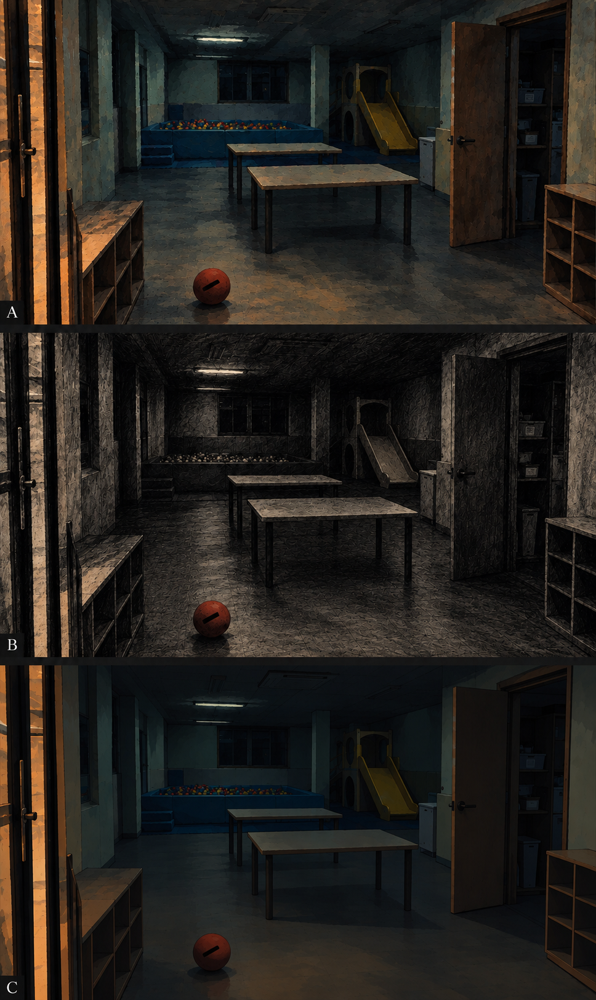

# 031 화면 스타일·보이스 선택

본편 세 편과 별도 쇼츠 세 편의 원고는 2026-10-18 승인됐습니다. 아래 조합은 **이번 회차의 화면 스타일·보이스 제안**입니다. 프로필은 `horror_cinematic_story_v1`, 본편 1920×1080 60fps와 별도 쇼츠 1080×1920 60fps로 추천합니다.

## 추천 조합

| 이야기 | 추천 스타일과 이유 | 실제 화면 방향 | 대안 |
| --- | --- | --- | --- |
| 맨 뒤 카트의 젖은 손잡이 | **거친 2D** — 철망·손·체인의 겹침을 단순한 윤곽으로 구분하기 좋습니다. | 어두운 청회색 바탕과 황색 작업등, 빨간 테이프. 무광 손그림 질감. 보관장 전체→바닥→손잡이로 시점을 바꾸고 소매 가림과 느린 접근을 사용합니다. 젖은 손자국과 손가락 경계는 밝게 남깁니다. | 실사풍: 금속·물방울 현실감과 국소 초점 / 그림자극: 검은 실루엣·호박색 역광, 접촉 윤곽 강조 |
| 방음벽 안에서 따라오는 것 | **어두운 회화** — 단단한 금속과 거칠고 납작한 존재의 표면 차이가 불쾌감을 만듭니다. | 남색 벽·회색 금속·흰 분필·황색 작업등. 거친 과슈 붓질. 상부 전체와 낮은 틈의 새 시점, 국소 조명과 절제된 시차를 사용합니다. 여섯 줄과 발목 접촉은 주변보다 밝게 둡니다. | 거친 2D: 동선·마디 구분이 명료 / 초기 3D: 녹회색 각진 공간·거친 텍스처, 점검로 깊이 강조 |
| 예비 버스의 다음 정류장 | **픽셀아트** — 고정된 버스의 행선지 변화와 빈 운전석을 간결하게 비교하기 좋습니다. | 어두운 남색 차고지·녹회색 버스·황색 보행선·흰 행선지. 큰 픽셀과 제한된 디더링. 격자에 맞춘 이동, 문과 표시의 작은 변화. 정확한 한글은 편집으로 크게 입력합니다. | 초기 3D: 차고지 원근·차량 동선이 명확 / 실사풍: 현실적인 차체와 미세한 문 움직임 |

대안별 밝기·재료·모션과 모바일 가독성, 9가지 후보 전체 검토는 [상세 후보표](visual-options.md)에 있습니다. 한 이야기의 본편·새 세로 쇼츠 이미지·썸네일은 선택한 스타일을 공유합니다.

## 기존 스타일 시안

아래 이미지는 기존 카탈로그의 **표현 방식 비교용 시안**입니다. 이번 이야기의 최종 장소나 제작 자산이 아닙니다.

첫 비교 이미지의 **A(맨 위)는 회화**, **B(가운데)는 먹·목탄**, **C(맨 아래)는 거친 2D**입니다. 이번 추천은 카트=C, 방음벽=A에 해당합니다.

차고지에 추천하는 픽셀아트의 기존 시안입니다. 실제 제작에서는 빈 운전석과 행선지 글자가 모바일에서 읽히도록 단서 밝기를 확보합니다.

## 보이스

이번 회차는 **C01 여성 Jian.K / C02 남성 / C03 남성**을 우선 추천한다. 이야기별 성별을 먼저 검토한 뒤 실제 보이스를 선택한다. 여성 1순위 Jian.K는 여성 캐스팅으로 추천한 C01에 적용한다. 두 화자 구성과 C01 Jian.K는 승인됐고, 남성 보이스는 2026-10-18 A · Hyuk으로 선택됐다.

| 이야기 | 우선 추천·음색 | 이유 | 다른 성별 대안 |
| --- | --- | --- | --- |
| C01 카트 | 여성 Jian.K, 차분한 중저음 | 손자국과 손목 감각을 가까운 구술로 쌓고 접촉 순간에만 긴장 상승 | 남성의 건조한 일상 증언도 가능. 작은 불안이 묻히지 않는지 확인 |
| C02 방음벽 | 남성, 자연스러운 중저음과 점진적으로 짧아지는 호흡 | 공간 관찰에서 직접 신체 위협으로 바뀌는 감정 폭 | 여성 Jian.K도 중반 정적에 적합. 후반 호흡 변화 비교 필요 |
| C03 차고지 | 남성, 정확하고 건조한 경험담 | 기록·봉인·표시를 차례로 확인하는 화자와 무인 이동의 대비 | 여성 Jian.K도 명료한 관찰에 적합. 마른 증언 질감 비교 가능 |

세 주인공의 성별은 승인 원고에서 고정되지 않았고 직업만으로 성별을 정하지 않았다. 남성 보이스의 실제 이름과 ID는 이번 대사 샘플을 비교한 뒤 제안한다. 본편과 각 이야기의 별도 쇼츠는 같은 캐스팅을 기본으로 검토한다. 상세 이유·대안·선택 상태는 [voice-plan.json](../00_brief/voice-plan.json)에 기록했다.

본편은 V4 원본 1.00x, 쇼츠는 별도 생성 후 피치 보존 1.07x 후처리 기본값입니다.

**확인할 선택:** 프로필 `horror_cinematic_story_v1` / 카트=거친 2D / 방음벽=회화 / 차고지=픽셀 / 보이스=C01 여성 Jian.K / C02 남성 / C03 남성(남성 실제 보이스는 샘플 비교 후 선택).

이 선택이 확정되면 승인 원문으로 음성을 생성하고 캐릭터·장소·존재 기준과 장면 자산을 제작합니다. BGM은 음성 검수 뒤 새 후보를 제시하는 별도 승인 단계입니다.

## 승인 기록

2026-10-18 사용자 “추천 스타일 조합 승인”. 프로필과 세 편 추천 스타일을 확정했다. 남성 샘플 A/B 선택과 BGM 승인은 별개로 대기 중이다.
